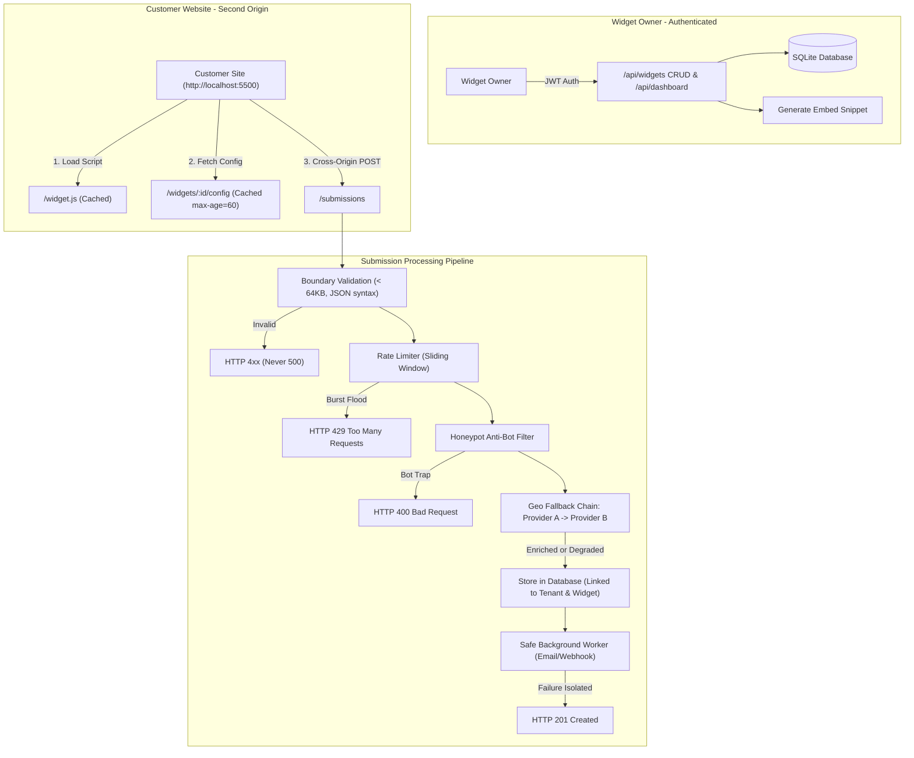

# 🚀 Embeddable Widget & Lead-Capture Platform

> **FlyRank Internship · Backend Track Capstone**  
> A hardened, multi-tenant backend platform allowing customers to embed lead-capture widgets on any website with a single `<script>` line, safely ingesting, validating, spam-filtering, geo-enriching, and storing public submissions.

[](https://www.python.org/)
[](https://fastapi.tiangolo.com/)
[](LICENSE)
[](tests/)

---

## 📌 Architecture Overview

### ASCII Dataflow
```
Widget Owner (authenticated)
  → /api/widgets (Tenant-Isolated CRUD) 
  → /api/dashboard (Stats & Aggregations)
  → Embed snippet generated

Customer Website (Any Origin, e.g. http://localhost:5500)
  <script src="http://localhost:8000/widget.js?id=w_123"></script>
  → GET /widgets/:id/config (Public, Cached, CORS)
  → Render Isolated Widget Form

Website Visitor
  → POST /submissions (Public, Cross-Origin CORS)
      │
      ├── 1. Boundary Validation (Malformed/Oversized → 4xx, never 500)
      ├── 2. Abuse Protection (Sliding window rate limit → 429)
      ├── 3. Bot Defense (Honeypot trap → dropped/rejected)
      ├── 4. Geo Enrichment Chain (Provider A → Provider B → store anyway)
      ├── 5. Atomic Storage (Linked to Widget & Tenant)
      └── 6. Safe Async Side Effects (Email/Webhook failure never blocks 201)
```

### Mermaid Architecture Diagram


---

## ⚡ Quick Start & Run Commands

### 1. Prerequisites
- Python 3.12+
- `pip`

### 2. Setup
```bash
# Clone the repository
git clone https://github.com/shazilahmed/flyrank-capstone-widget-platform.git
cd flyrank-capstone-widget-platform

# Install dependencies
pip install -r requirements.txt

# Create .env from template (secrets stay local, never committed)
copy .env.example .env
```

### 3. Seed Demo Data
```bash
python -m app.seed
```
*Creates demo tenants, pre-configured widgets, and historical submissions:*
- **Tenant A:** `tenant.a@example.com` / `Password123!` (Widgets: `widget-demo-newsletter`, `widget-demo-contact`)
- **Tenant B:** `tenant.b@example.com` / `Password123!` (Widget: `widget-demo-beta`)

### 4. Run the API Server
```bash
python -m app.main
```
The server runs at `http://localhost:8000`.  
- Interactive Swagger API Documentation: `http://localhost:8000/docs`
- Health check: `http://localhost:8000/health`

### 5. Run the Customer Test Site (Second Origin)
```bash
# In a separate terminal, serve the demo page on port 5500:
python -m http.server 5500 --directory customer_site
```
Open **`http://localhost:5500`** in your browser to test the embeddable widget live across origins!

### 6. Run the Test Suite
```bash
python -m pytest -v
```
*All 18 automated tests passing (including all 6 acceptance probes).*

---

## 📡 API Specification

### Authentication (`/api/auth`)
- `POST /api/auth/register` — Register tenant `{ "email", "password", "company_name" }`
- `POST /api/auth/login` — Login and receive JWT `{ "access_token", "token_type" }`
- `GET /api/auth/me` — Authenticated profile (Requires `Authorization: Bearer <token>`)

### Widget Management (`/api/widgets` — Tenant-Isolated)
- `GET /api/widgets` — List all widgets owned by authenticated tenant
- `POST /api/widgets` — Create widget with fields, buttons, and display options
- `GET /api/widgets/{id}` — Fetch widget details + generated `<script>` embed snippet
- `PUT /api/widgets/{id}` — Update widget
- `DELETE /api/widgets/{id}` — Delete widget (cascades associated submissions)

### Public Delivery (`/widget.js`, `/widgets/{id}/config`)
- `GET /widget.js?id={id}` — Dynamic loader script (`Cache-Control: public, max-age=3600`)
- `GET /static/widget.v1.js` — Versioned bundle (`Cache-Control: public, max-age=31536000, immutable`)
- `GET /widgets/{id}/config` — Public JSON configuration (`Cache-Control: public, max-age=60`, CORS enabled)

### Public Submission (`/submissions` — Hardened)
- `OPTIONS /submissions` — CORS preflight handler
- `POST /submissions` — Form submission ingestion:
  - Header: `Content-Type: application/json`
  - Optional Header: `Idempotency-Key: <key>`
  - Body: `{ "widget_id": "...", "data": { ... }, "website_hp": "" }`
  - Responses: `201 Created`, `400 Bad Request` (Validation/Honeypot), `413 Content Too Large` (>64KB), `429 Too Many Requests` (Rate limit burst).

### Owner Dashboard (`/api/dashboard`)
- `GET /api/dashboard/stats` — Aggregations: total submissions, last 24h, last 7d, per-widget count, geo breakdown
- `GET /api/dashboard/submissions` — Paginated submissions list for tenant's widgets

---

## 🎯 Acceptance Probes Verification

| Probe | Condition | Behavior | Status |
| :--- | :--- | :--- | :--- |
| **PROBE 1** | POST from `http://localhost:5500` | Stored, returns 201, visible in `/api/dashboard/submissions` | **PASS** |
| **PROBE 2** | Malformed JSON & >64KB body | Clean 400 Bad Request & 413 Content Too Large (Never 500) | **PASS** |
| **PROBE 3** | Rapid submission burst | Returns 429 with `Retry-After`; other IPs unthrottled | **PASS** |
| **PROBE 4** | Provider A down / Both down | Provider B enriches; if both down, degrades gracefully without failing | **PASS** |
| **PROBE 5** | Side effect exception | Exception isolated; main submission succeeds with HTTP 201 | **PASS** |
| **PROBE 6** | Bot fills honeypot field | Rejected with HTTP 400 Bad Request | **PASS** |

See [`EVIDENCE.md`](EVIDENCE.md) for full execution transcripts and test logs.

---

## ⚠️ Limitations & Architectural Trade-Offs

1. **Database:** Built with SQLite + `aiosqlite` with WAL mode for zero external dependencies and 100% portability ($0 stack, no credit card, no Docker required). Production deployments can swap `DATABASE_URL` to PostgreSQL.
2. **Rate Limiting:** Implemented via an in-memory sliding window deque. For multi-node distributed clusters, the same interface can be backed by Redis.
3. **Secondary Side Effects:** Dispatched using asynchronous background execution with retry logic and alert logging to console. Can be integrated with Celery / SQS for high-volume enterprise queues.
